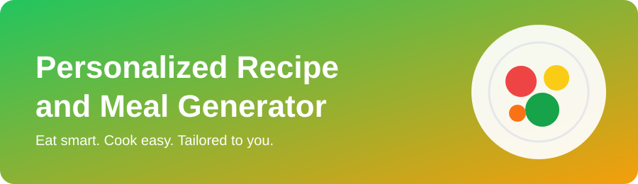
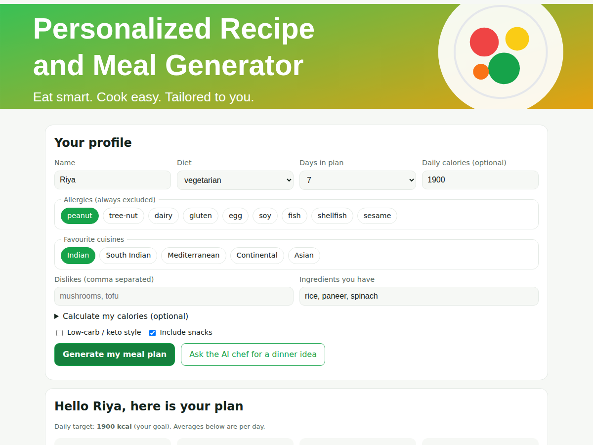
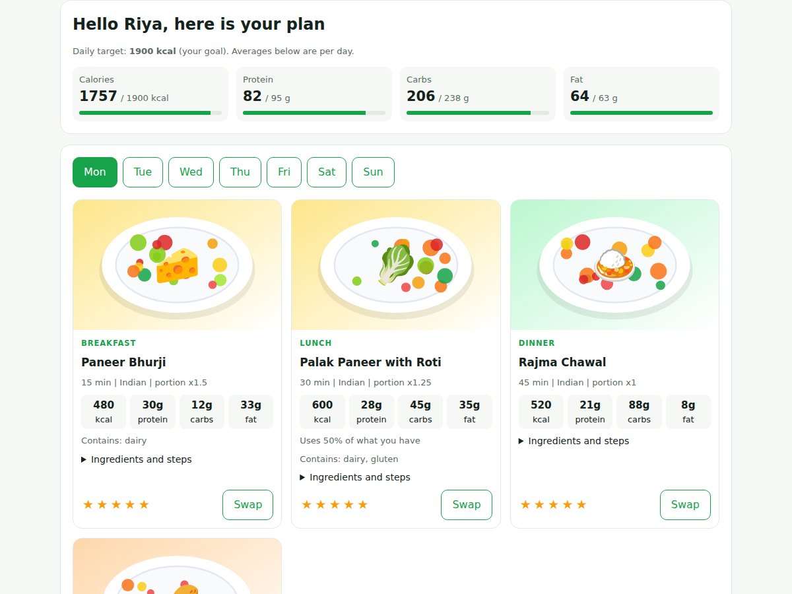
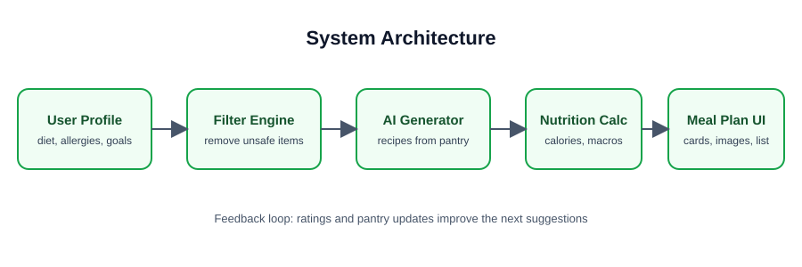

# 🍽️ Personalized Recipe & Meal Generator

A working web app that builds **personalized recipes and weekly meal plans** from your diet, allergies, calorie goal, favourite cuisines and the ingredients already in your kitchen. It also produces a categorised shopping list, and can ask an **AI chef** (optional) for fresh ideas.

| Your profile and plan | Meal cards with images |
|---|---|
|  |  |

## ✨ Features
| Feature | How it works |
|---|---|
| 🛡️ **Safety first** | Allergies and diet rules are **hard filters** and are never relaxed. If nothing safe exists, the app says so instead of guessing. |
| 🎯 **Calorie targets** | Enter a goal, or let the app calculate it (Mifflin-St Jeor + activity + goal). Portions are scaled in 0.25 steps (x0.75 to x1.5) to hit each meal's share of the target. |
| 🧊 **Pantry matching** | Recipes using more of your existing ingredients score higher. Staples (oil, salt, spices) are ignored. |
| 📅 **1-7 day plans** | Breakfast, lunch, dinner and optional snack. No repeats within a day, repeats across days are penalised. |
| 🔁 **Swap** | Replace any meal with another safe option. The shopping list and totals update. |
| ⭐ **Learns from ratings** | Ratings are stored; 1-2 star recipes are pushed down, 4-5 star recipes up. |
| 🛒 **Shopping list** | Quantities merged across the plan, grouped by category, items you already have are pre-ticked. |
| 🥑 **Low-carb mode** | Prefers keto-tagged recipes; relaxes only if the diet leaves none (and tells you). |
| 🤖 **AI chef (optional)** | Uses the Anthropic API. Every AI recipe is re-checked for allergens, diet and dislikes, and rejected if unsafe. |
| 🖼️ **Images** | Each of the 42 recipes has its own generated SVG plate illustration. |
| 🖨️ **Print** | Print-friendly layout of the whole plan. |

## 🏗️ Architecture


```
Browser (HTML/CSS/JS)  --JSON-->  Flask API (app.py)
                                      |
        +-----------+-----------+-----+------+-------------+
     profile.py  filters.py  generator.py  planner.py   ai.py (optional)
     validation  allergy/    scoring and   plans, swap,  Anthropic API +
                 diet rules  portions      shopping      safety re-check
                                      |
                       data/recipes.json  +  data/feedback.json
```

## 📁 Project structure
```
recipe-meal-generator/
├── realme.md              # this file
├── app.py                 # Flask app + API routes
├── core/
│   ├── profile.py         # input validation (Profile)
│   ├── filters.py         # hard allergy / diet / dislike filters
│   ├── nutrition.py       # BMR, calorie and macro maths
│   ├── generator.py       # scoring, portion scaling
│   ├── planner.py         # weekly plan, swap, shopping list
│   ├── ai.py              # optional AI chef (stdlib only)
│   └── store.py           # recipe loader + ratings store
├── data/recipes.json      # 42 curated recipes
├── static/                # index.html, style.css, app.js, images/
├── tools/generate_images.py   # regenerates recipe illustrations
├── tests/test_core.py     # 30 automated tests
├── docs/images/           # README images and screenshots
├── requirements.txt  Dockerfile  run.sh
```

## 🚀 Quick start
```bash
cd recipe-meal-generator
./run.sh                      # creates a venv, installs Flask, starts the app
# or manually:
pip install -r requirements.txt
python app.py                 # open http://127.0.0.1:5000
```
Enable the AI chef (optional):
```bash
export ANTHROPIC_API_KEY="your_key"
# optional: export ANTHROPIC_MODEL="claude-sonnet-4-6"
```
Docker: `docker build -t meal-gen . && docker run -p 5000:5000 meal-gen`

## 🔌 API
| Method | Endpoint | Purpose |
|---|---|---|
| GET | `/api/meta` | Options for the form, recipe count, whether AI is enabled |
| POST | `/api/target` | Calorie and macro targets (+ BMI) from a profile |
| POST | `/api/plan` | Generate a plan, summary, notes and shopping list |
| POST | `/api/swap` | Swap one meal (`profile`, `spec`, `day`, `index`) |
| POST | `/api/feedback` | Save a 1-5 rating (`recipe_id`, `rating`) |
| POST | `/api/ai-recipe` | One AI-generated recipe (503 if no API key) |

Example:
```bash
curl -X POST localhost:5000/api/plan -H 'Content-Type: application/json' \
  -d '{"profile":{"diet":"vegetarian","allergies":["peanut"],"calorie_goal":1800,"pantry":"rice, paneer","days":3}}'
```
Profile fields: `name, diet (vegan|vegetarian|non-veg), allergies, dislikes, pantry, cuisines, calorie_goal, age, sex, weight_kg, height_cm, activity, goal, low_carb, days, include_snacks, seed`.
Allergens: peanut, tree-nut, dairy, gluten, egg, soy, fish, shellfish, sesame. *(Vegetarian here includes eggs and dairy.)*

## 🧪 Tests
```bash
python -m unittest discover -s tests -v
```
30 tests cover validation, calorie maths, plan structure, pantry influence, swaps, shopping-list merging, ratings, the AI safety gate (with a fake AI), the API and error handling. A randomised test builds many plans across all diets and allergy combinations and asserts **no plan ever contains a selected allergen**.

## ➕ Adding recipes
Add an entry to `data/recipes.json` (fields: `id, title, meals, diet, allergens, cuisine, minutes, nutrition, ingredients, steps, emoji, tags, color, image`), then run `python tools/generate_images.py`. The tests check that every recipe is complete, has an image, and that allergen tags match its ingredients. New ingredient names should be added to a category in `core/planner.py` (a test fails if one is uncategorised).

## ⚠️ Limitations
- Nutrition values are estimates for a small curated set, not medical advice. Always check labels if you have allergies. For health conditions consult a dietitian.
- Only 42 recipes, so strict combinations (for example vegan plus many allergies plus low-carb) may produce repeats or a note that options are limited.
- Ratings are shared by everyone using one server (no user accounts).
- Recipe images are illustrations, not photographs.

## 🗺️ Ideas for next steps
User accounts, photo-of-fridge ingredient detection, budget-aware plans, more regional cuisines, PDF export, a larger recipe database.

## 📄 License
MIT.
